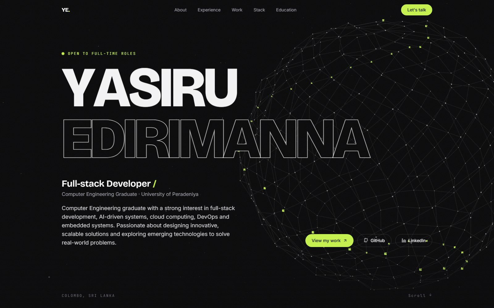

# Yasiru Edirimanna - Portfolio

**Live site: [yasiru-portfolio-blj2.vercel.app](https://yasiru-portfolio-blj2.vercel.app/)**

Personal portfolio of Yasiru Harinda Edirimanna, a software engineer and Computer Engineering graduate
of the University of Peradeniya. A single-page site with a WebGL hero, scroll-driven animations and
in-depth case studies of my main projects.



## What's on the site

| Section | What it shows |
|---|---|
| **Hero** | Animated name over an interactive Three.js network scene, open-to-work status, links to GitHub, LinkedIn and Medium |
| **About** | Bio that lights up word by word as you scroll, a photo that fades from black-and-white to colour, quick stats |
| **What I do** | Three focus areas (full-stack, cloud & DevOps, AI engineering), each tied to the projects that prove it |
| **Experience** | Scroll-drawn timeline: WSO2 software engineering internship and university teaching |
| **Selected work** | Three featured case studies (below), then a draggable, filterable slider of more projects |
| **Tech stack** | Scrolling marquee plus skills grouped by area |
| **Background** | Education, certifications (including WSO2 Identity Server V7), achievements and activities |
| **Contact** | Email (with copy button), LinkedIn, GitHub and Medium |

### Featured projects
- **[WSO2 GRC Platform](https://github.com/wso2-open-operations/grc-tools)**: Governance, Risk & Compliance platform with an AI agent that validates audit evidence (Go, React, Claude API)
- **[OrderFlow](https://github.com/YasiruHarinda/orderflow)**: event-driven .NET 10 microservices on Azure AKS with GitOps and canary releases
- **[PEBO](https://cepdnaclk.github.io/e20-3yp-P-E-BO-Desk-Companion/)**: AI desk companion robot (Raspberry Pi, Gemini, AWS Rekognition), with a photo gallery

The GRC Platform and OrderFlow have animated SVG architecture diagrams; PEBO has a photo gallery.

### More projects (slider)
- **AI-Driven Feedback & Tutoring System**: final-year project, a multi-agent LLM grading and feedback pipeline connected to Moodle
- **DECP**: Department Engagement & Career Platform, web and mobile (Node.js, Firebase, React Native)
- **[CodeCity 3D](https://github.com/YasiruHarinda/codecity)**: turns any git repository into an interactive 3D city ([live demo](https://yasiruharinda.github.io/codecity/))
- **[Mini Git](https://github.com/YasiruHarinda/mini-git)**: git's object model rebuilt from scratch in TypeScript, verified against real git ([live demo](https://yasiruharinda.github.io/mini-git/))
- **Mona Dashboard**: real-time factory production monitoring
- **Air Quality Analyser**: hybrid LSTM and fuzzy-logic forecasting
- **Asset & Income Tracker**: Flutter app with Firebase
- **This portfolio**
- **[Buy or Wait?](https://github.com/YasiruHarinda/hackerrank-orchestrate-september26)**: HackerRank Orchestrate 24-hour hackathon, an AI agent that decides if a user can safely afford a purchase (Python, Claude API)

## Tech stack

| Purpose | Library |
|---|---|
| UI | React 19, Vite 7 |
| Styling | Tailwind CSS 3 |
| Scroll animations | GSAP + ScrollTrigger |
| Smooth scrolling | Lenis |
| 3D hero scene | Three.js (lazy-loaded) |
| Transitions | Framer Motion (nav pill, filters, galleries, slider cards) |
| Icons | react-icons |
| Hosting | Vercel (deploys automatically on every push to `main`) |

## Run locally

Requires **Node.js 20 or newer**.

```bash
npm install
npm run dev        # http://localhost:5173
```

| Command | What it does |
|---|---|
| `npm run dev` | Start the dev server with hot reload |
| `npm run build` | Production build into `dist/` |
| `npm run preview` | Serve the production build locally |
| `npm run lint` | Run ESLint |

## Project structure

```
public/images/          profile photo, project images, PEBO gallery photos
src/
  data/
    portfolio.js        ALL site content: profile, projects, experience, skills, certifications…
    diagrams.js         architecture diagrams for the featured projects
  components/
    Hero.jsx            name animation + links;  HeroScene.jsx: Three.js network
    About.jsx           bio, photo, stats
    WhatIDo.jsx         focus areas
    Experience.jsx      timeline
    Work.jsx            featured projects + filters
      FeaturedProject.jsx    case-study card (diagram or photo gallery)
      ArchitectureDiagram.jsx, ProjectGallery.jsx
      ProjectSlider.jsx      horizontal slider of more projects
      ProjectCard.jsx        card used in the slider
    TechStack.jsx       marquee + grouped skills
    Education.jsx       education, certifications, achievements
    Contact.jsx         contact links + footer
    Navbar.jsx, SectionHeading.jsx, SpotlightOverlay.jsx
  lib/
    scroll.js           GSAP + Lenis setup and scroll-to-section
    asset.js            prefixes image paths with the site's base URL
  App.jsx               page layout and scroll-reveal animations
  index.css             Tailwind layers, design tokens, slider styles
```

## Editing content

Everything you see on the site comes from **`src/data/portfolio.js`**. You don't need to touch the components to update it.

- **Profile, links and status:** `PROFILE`
- **A job or teaching role:** add an entry to `EXPERIENCE`
- **A certification:** add `{ title, issuer, year, href }` to `CERTIFICATIONS` (the count in the About section updates automatically)
- **A project in the slider:** add an entry to `PROJECTS` with `categories` from `PROJECT_FILTERS`, and put its image in `public/images/projects/`
- **A featured case study:** add an entry to `FEATURED_PROJECTS` with either:
  - `diagram: "<key>"`, plus a matching diagram in `src/data/diagrams.js` (nodes on a 640-wide canvas, plus edges), or
  - `gallery: [{ src, alt, caption }]`, which shows a photo gallery instead (add `fit: "contain"` for screenshots or drawings that shouldn't be cropped)

Image paths start with `/images/...` and point into `public/images/`. Keep photos under about 200 KB each; resize large camera photos before adding them.

## Accessibility & performance
- Respects `prefers-reduced-motion`: no smooth scrolling, no scroll animations, a static 3D scene
- The 3D scene is code-split from the main bundle and pauses when it's off-screen
- The project slider works with mouse drag, touch, trackpad, arrow buttons and keyboard
- Keyboard focus styles, a skip link, and alt text on meaningful images (decorative ones are hidden from screen readers)

## License
The **source code** is released under the [MIT License](LICENSE).
**Personal content** (photos, biography, project write-ups and other details in `public/images/` and `src/data/`) is © Yasiru Harinda Edirimanna, all rights reserved; please don't reuse it. Some project photos belong to third parties. See [LICENSE](LICENSE) for details.
